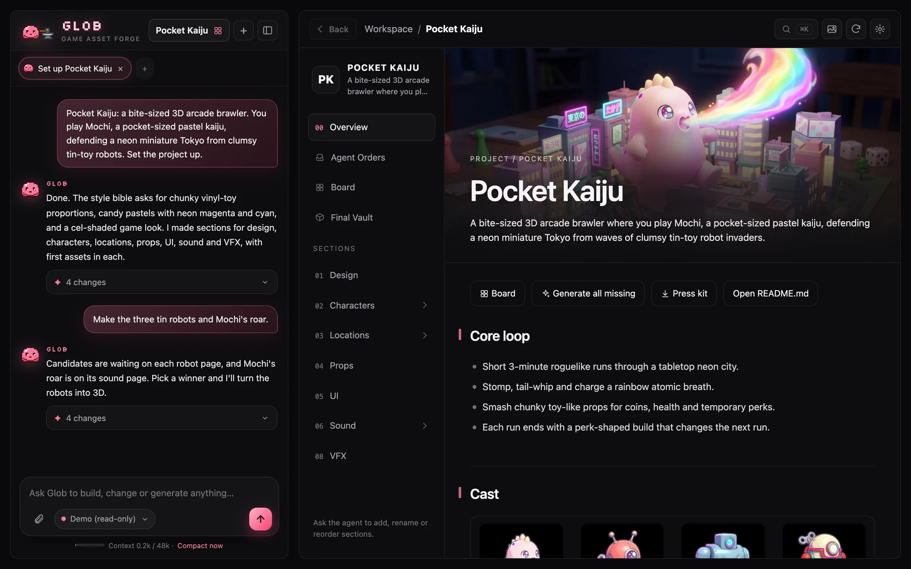
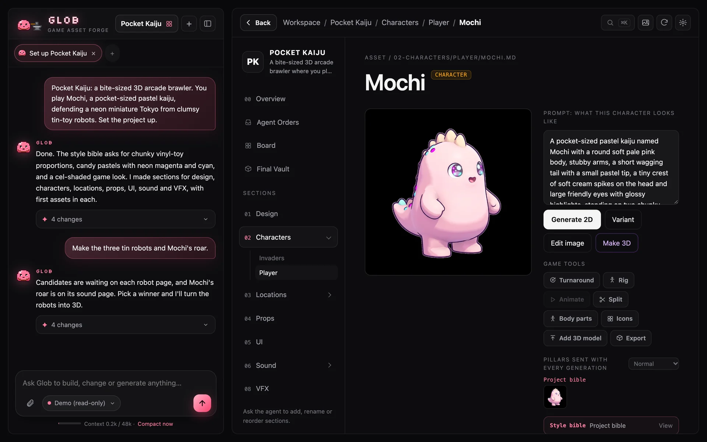
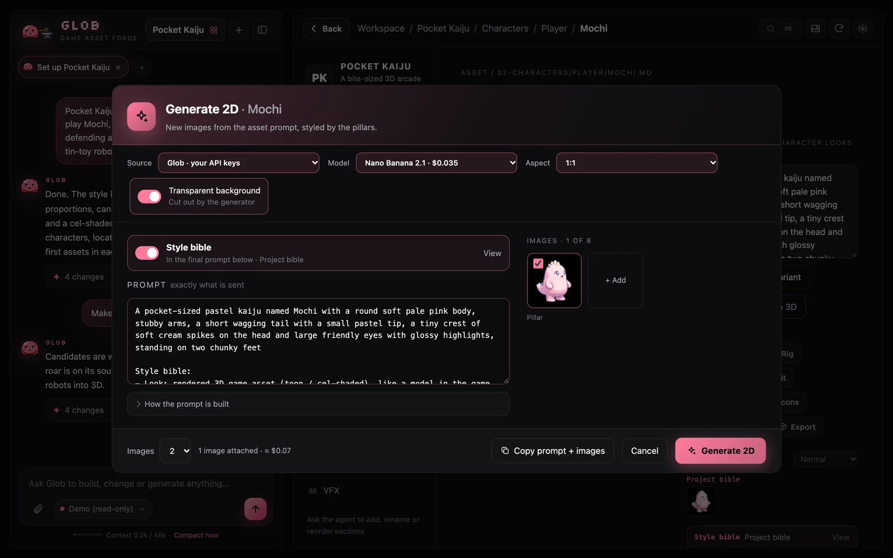
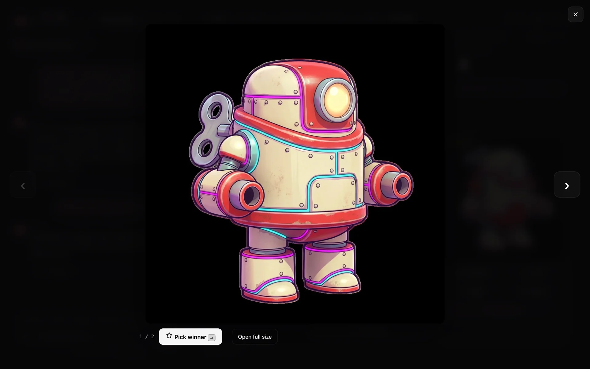
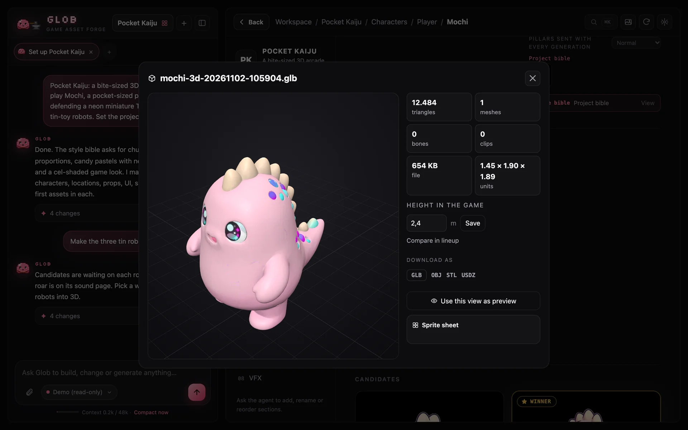
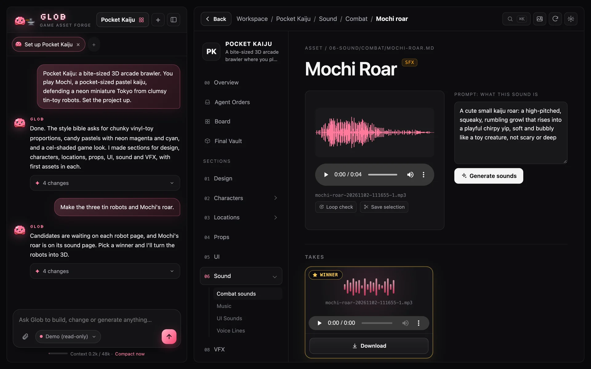
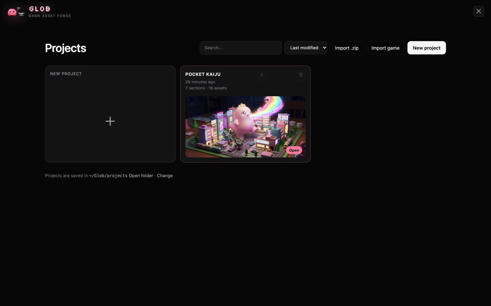
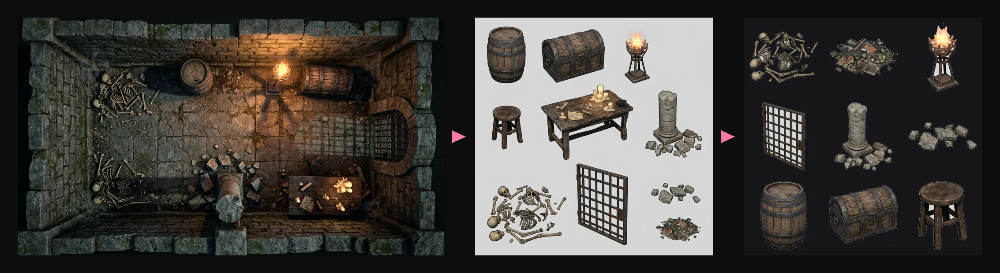

<div align="center">



# Glob

### Make the art. Your coding agent puts it in the game.

Glob is an asset studio for your game. It runs as its own app and makes 2D art, 3D models, rigs, animations, icons, sounds and whole level kits.<br>
Your coding agent copies the finished files from Glob into your game.

### [⬇ Download for Windows](https://github.com/SoulNassim/Glob-Game-Forge/releases/latest/download/Glob-Setup-Windows.exe) · [⬇ Download for macOS](https://github.com/SoulNassim/Glob-Game-Forge/releases/latest/download/Glob-macOS.dmg)

Free. Install it, pick your game's folder, and your coding agent finds the art on its own.

[**Get started**](#get-started) · [**▶ Live demo**](https://soulnassim.github.io/Glob-Game-Forge/demo/) · [Website](https://soulnassim.github.io/Glob-Game-Forge/) · [What you can make](#what-you-can-make)

**Free and open source (MIT).** Sign in to the generators you use (or paste a key). No markup, no subscription.

**New in 3.0:** Glob is an app with a tray icon, a level kit (one picture → one prop sheet → every prop cut out for free), 2D and 3D projects, simpler settings, and a much faster studio. [What changed](#whats-new-in-30)

</div>

## How it works

Glob is an app you open: double-click the **Glob** shortcut on your desktop or in the Start menu, or run `glob-app`. It opens in its own window and keeps running in the background, with a tray icon (**Open Glob**, **Quit Glob**). *Settings → Files & app* shows where it is installed.

Glob has its own chat, a separate session from your coding agent. It runs on your Claude Code or Codex login, no API key needed. The chat organizes the workspace, writes style and prompts, and generates art. Your coding agent never manages the workspace.

The flow:

1. **Make or pick the art in Glob.**
2. **Your coding agent copies it.** Glob keeps `<game>/glob/ASSETS.md`, an index of every asset: its name, kind, page, the picked image or sound (`winner:`), and any 3D model, rig and animation files. The agent reads it and copies the files it needs into your game's own folders. It never edits or moves anything inside `glob/`.
3. **Missing art stays a placeholder.** The agent keeps the placeholder and tells you what's needed. You make it in Glob.



<p align="center"><b>Pocket Kaiju</b>: a sample game made entirely in Glob, with 16 assets, 3D models and sounds.<br>
<a href="https://soulnassim.github.io/Glob-Game-Forge/demo/"><b>▶ Click through it in the live demo</b></a>: the real app in your browser, read-only, no keys needed.</p>

## What you can make

| | |
|---|---|
| 🎨 **2D art** | Characters, items, environments, UI, VFX. A **style bible** and reference **pillars** go into every prompt, per folder, so everything matches |
| 🧊 **3D models** | From the winner image, with poly count, game height, a 3D lineup next to a 1.7 m person, and OBJ / STL / USDZ export |
| 🦴 **Rigs and animations** | Rig a model and add animations from a library |
| 🔊 **Sounds** | Sound effects, voices and music, with a real waveform, trimming and a loop check |
| 🗂️ **Game icons** | Turn any image into square, transparent inventory icons (32 to 512 px) in one click |
| 🗺️ **Level kits** | Picture a level section, get every prop in it on **one** sheet, and Glob finds, names and cuts out each prop on your computer. Two image calls instead of one per prop |
| ✂️ **Sprites and parts** | Cut a sheet into parts or new assets, render sprite sheets from a 3D model |
| 🎮 **Prototypes** | A rough, playable sketch built from your art, to test if the idea is fun. It runs sandboxed, and you can ask for changes |
| 📦 **Press kit** | One ZIP with a web page of your key art, winners, turning 3D models and sounds |

<table>
<tr>
<td><br><sub>An asset: winner, prompt and what to do next.</sub></td>
<td><br><sub>Model, price and the exact prompt before anything is sent.</sub></td>
</tr>
<tr>
<td><br><sub>Pick the winner big, with 1–9 and Enter.</sub></td>
<td><br><sub>3D viewer with poly count, game height and export.</sub></td>
</tr>
<tr>
<td><br><sub>Sounds with a waveform you can trim and loop-check.</sub></td>
<td><br><sub>Every project with its key art.</sub></td>
</tr>
</table>

### Levels



Open **Levels** in the sidebar and press **New level**.

1. **Describe the place and pick a picture.** Nothing else is made until you approve one.
2. **Press Turn into asset pack.** Tick what you want and see the cost first. Walls, floors and ceilings can't be cut out of a picture because its perspective and lighting are baked in, so Glob redraws each one from your picture, flat-on. They match the look but aren't exact copies. The default is three walls, two floors, a ceiling, a prop sheet and a trim sheet of pillars, arches and door frames: eight images.
3. **Glob does the rest for free.** It cuts and names the props and trim, makes each surface seamless with normal, roughness and height maps, and builds the modular kit. If an image fails, the rest still finishes, and pressing **Finish pack** only makes what's missing.
4. **Tick which props go 3D.** The total shows before anything is spent, and the rest stay free cut-outs.

Your coding agent finds it all in `glob/ASSETS.md`. The kit is one GLB with every piece as a named node (floor, ceiling, wall and its variants, low wall, doorway, window, inner and outer corners, pillar, stairs), a sample room, and `kit.json`, which lists each piece's size, pivot, rotations and what each side connects to, so it can write a level generator without guessing.

**Walls with real depth:** AI meshes never line up, so Glob builds the pieces itself at exact sizes and presses the surface's height map into them. Cracks and bricks are real geometry, and each piece stays inside its cell, so neighbours still meet. Every piece with relief also has a plain `_lod1` version for distance and collision.

You can also make a **Material** or **Modular kit** asset by hand and pick your own surfaces. Regular patterns such as bricks work best when the generated image already tiles; on other images a cut can show where the two sides were joined, so check the repeating preview.

## Get started

### 1. Download Glob

[**Windows installer**](https://github.com/SoulNassim/Glob-Game-Forge/releases/latest/download/Glob-Setup-Windows.exe) · [**macOS app**](https://github.com/SoulNassim/Glob-Game-Forge/releases/latest/download/Glob-macOS.dmg) · or any build on the [releases page](https://github.com/SoulNassim/Glob-Game-Forge/releases).

Glob isn't code-signed yet. Windows may say "Windows protected your PC": click **More info → Run anyway**. On macOS, right-click Glob → **Open** the first time.

### 2. Open it and point it at your game

Glob opens in its own window. Make a project, pick your game's folder (or paste its path, or start without one), and sign in to a generator in **Settings → Accounts**. One ElevenLabs sign-in already gives you images and sounds. Keys stay on your computer.

Picking the game folder makes the project in `<game>/glob/` and writes a short note into the game's `AGENTS.md` and `CLAUDE.md`.

### 3. Your coding agent finds it

Coding agents read `AGENTS.md` (Codex, Cursor, Copilot, OpenCode, Gemini CLI) or `CLAUDE.md` (Claude Code) on their own. The note tells them Glob's art is listed in `glob/ASSETS.md`. Make art in Glob, then ask your agent:

> *"Use the Glob art for the knight."*

It copies the files into your game and keeps placeholders for anything you haven't made yet. Nothing to install in the agent, no MCP server, no restart. If an agent ever misses the note, tell it once: *"Read glob/ASSETS.md and copy the Glob art you need."*

<details>
<summary><b>Other ways to install</b>: let your agent do it, or the command line</summary>

**Let your coding agent do it.** Paste this into your agent, from your game's folder. It follows [`docs/agent.md`](docs/agent.md): installs Glob (you approve one command) and runs `glob connect`.

```text
Set up Glob for this game: read https://soulnassim.github.io/Glob-Game-Forge/agent.md
```

**Command line:**

```bash
# Already have uv (any OS)
uv tool install --python 3.12 "forge-assets @ https://github.com/SoulNassim/Glob-Game-Forge/archive/refs/heads/main.zip"
```

```powershell
# Windows (PowerShell)
irm https://raw.githubusercontent.com/SoulNassim/Glob-Game-Forge/main/scripts/install.ps1 | iex
```

```bash
# macOS / Linux
curl -LsSf https://raw.githubusercontent.com/SoulNassim/Glob-Game-Forge/main/scripts/install.sh | sh
```

Then, in a new terminal, in your game folder:

| Command | What it does |
|---|---|
| `glob connect` | Makes or finds this game's Glob project, writes the note for your coding agents and opens Glob on it. |
| `glob open` | Opens Glob on this game's project, starting it in the background if needed. |
| `glob shortcut` | Puts a **Glob** shortcut on the desktop and in the Start menu (macOS: `Glob.command` on the desktop, Linux: the app menu). The installers and the first `glob connect` make it for you. |
| `glob` | Runs Glob in this terminal and opens <http://127.0.0.1:8420>. |

No game folder yet? Start a project without one and link the game later in **Settings → Your game**. You can also paste a folder path instead of using the folder window.

Projects are listed in `~/Glob/projects` (a source checkout uses its own `projects/`). A project made for a game keeps its files in that game's `glob/` folder.

From source, with Python 3.11+ and [uv](https://docs.astral.sh/uv/):

```bash
git clone https://github.com/SoulNassim/Glob-Game-Forge.git
cd Glob-Game-Forge
uv run forge
```

Glob opens in its own app window (`glob-app`, the Glob shortcut, or the installers on the [releases page](https://github.com/SoulNassim/Glob-Game-Forge/releases)). It keeps running in the background after you close the window; its tray icon (**Open Glob**, **Quit Glob**) opens or quits it.

</details>

<details>
<summary>What linking writes into your game folder</summary>

- A short note between `<!-- glob:start -->` and `<!-- glob:end -->` in `AGENTS.md` and `CLAUDE.md` (and `GEMINI.md` when the game has one), saying where the finished art is and that the agent copies it from `glob/ASSETS.md`.
- `glob/`, Glob's project for the game. Its `workspace/` folder holds the art, and `glob/ASSETS.md` indexes it. Your coding agent only reads `ASSETS.md` and copies files out; it never edits `glob/`.
- `glob/.gitignore`, so your game's git skips Glob's internal files (database, logs, job list) but keeps the art.

</details>

### 4. Build your game

Ask your agent for something that needs art:

> *"Add three enemy types with placeholder models. I'll make the real ones in Glob."*

Make the art in Glob (open it with the **Glob** shortcut, or `glob open` in your game folder). When you want it in the game, tell your agent. It copies the files from `glob/` using `glob/ASSETS.md`, and keeps placeholders for anything not made yet.

Already have a game? **Projects → Import game** takes a Godot, Unity or Unreal project, or any folder of art.

## More

<details>
<summary><b>Generators</b></summary>

**Settings → Accounts.** Sign in or paste a key; everything stays on this computer and you pay the providers directly. **Settings → New art** picks which service makes images and 3D, whether the project is a 2D or a 3D game (2D hides the 3D tools), and each kind's shape and background (characters tall and cut out, places very wide as a full scene, and so on). Model menus say who bills each model: a service's credits or your own key.

| Generator | Makes |
|---|---|
| ElevenLabs | Sound effects, voices, music and many image models (sign in, or paste a key) |
| Meshy | 3D models, rigging, animation, images (sign in, or paste a key) |
| fal, Higgsfield | Many image, video and 3D models (sign in) |
| Google Gemini | Images (key) |
| Tripo | 3D models (v3.1, v3.0, v2.5 and the low-poly P1/P2), rigs, preset animations, retopo, re-texture and format conversion. Tripo has no sign-in for apps, so Glob checks your API key with Tripo and shows your credits. Tripo Studio plan credits don't work with the API: **Settings → Accounts → Watched folder** prepares your images as batches of 30 for Studio, and puts the models you download onto their assets |
| Stability AI | Music and loops (key) |

Sound takes live in `<asset>/audio/`. For a voice, the prompt is the line to speak. Drop an MP3/WAV on an asset to add a take. A generator that isn't set up is refused with a message; it never saves a silent placeholder.

</details>

<details>
<summary><b>Import a game</b></summary>

**Projects → Import game** (or tell the Glob chat where your game is) scans a **Godot, Unity or Unreal** project, or any folder of game art, then shows a review step: untick sections, leave assets out, and rename or merge sections.

You get characters with their models, animations and textures, weapons, items and enemies with stats, kits, skies, texture packs, concept art, audio and design docs. Files are copied; your game folder is never changed.

</details>

<details>
<summary><b>Projects, workspaces and storage</b></summary>

- **Projects are folders.** Top-level folders are sections, `README.md` files are pages, and any `.md` with `kind:` and `prompt:` in its header is an asset. Readable, diffable and yours.
- **Export / import a workspace:** the download icon on a project card saves it as a `.zip`; **Projects → Import workspace** (or dropping the file on the projects page) brings it in on another computer.
- **Storage:** Settings → Files & app shows where your projects are (move them there), opens each project's folder, and tells you where Glob is installed.
- **Folder access:** Glob only sees its projects folder until you allow more, read or read & write. Keys, `.env` and key files are always off-limits.

</details>

<details>
<summary><b>All the small things</b></summary>

- **Style that sticks.** Images in `pillars/` and rules in `pillars/*.md` stack from the project root down. Any image becomes a pillar from its ⋯ menu. Pillar strength per asset: off, light, normal or strong.
- **Pick fast.** Click a candidate (or press `1`–`9`) to see it big; `←` `→` to step, `Enter` to pick the winner.
- **One image per run** by default; when a run makes a single image, it becomes the winner on its own.
- **Generate all missing.** Candidates for every asset that has nothing to pick from yet, with a cost estimate first.
- **3D lineup** stands every model at its game height.
- **Credits first.** The generate sheet warns when a provider ran out of credits, shows Meshy's balance, and won't start a 3D model you can't afford.
- **Kind icons.** An asset without art shows its kind's icon, so a new folder never looks empty.
- **Live workspace.** Edits from your agent show up at once.
- **⌘K / Ctrl+K** jumps to any asset or action. **G** toggles gallery mode.
- **Make key art** paints a project cover from its pitch.

</details>

<details>
<summary><b>Workspace conventions</b></summary>

| In the workspace folder | What Glob does with it |
|---|---|
| Top-level folder, e.g. `02-characters/` | A section; the number sets its order and is hidden in the title |
| `README.md` in a folder | That folder's page; its `# Heading` is the title, the first paragraph the summary |
| Root `README.md` (or `GAME.md`) | The project's front page |
| `cover.png` / `.jpg` / `.webp` | Hero image of its folder (at the root: the project's key art) |
| `.md` with `kind:` and `prompt:` in its header | An asset. Kinds: character, creature, item, weapon, prop, environment, level, vehicle, ui, vfx, sfx, voice, music |
| `pillars/*.png` (root = project bible) | Reference images sent with every generation at or below that folder |
| `pillars/*.md` | Style-bible text added in front of every prompt at or below that folder |
| `pillars:` / `aspect:` / `height_m:` in an asset header | Pillar strength, framing (`16:9`…) and height in metres |
| `cover: true` in an asset header | Its winner becomes the project cover |

Generated files are saved next to the asset (`<asset>/candidates|variants|edits|3d/`) and in the project vault with a JSON record of the exact prompt, images and model used.

</details>

<details>
<summary><b>Glob chat</b></summary>

Glob has its own chat next to your projects, separate from your coding agent. It runs on your Claude Code or Codex login. Ask it to organize the workspace, regroup sections, rewrite prompts or generate art. Your coding agent never manages the workspace.

</details>

<details>
<summary><b>Keys, costs and security</b></summary>

Glob itself is free; generation runs on your provider accounts, and the send screen shows the price first.

- Keys are saved in `~/.forge/config.json` (owner-only on macOS/Linux), masked in every API response, and never go into a project or export. They can also come from `GEMINI_API_KEY`, `MESHY_API_KEY`, `TRIPO_API_KEY`, `ELEVENLABS_API_KEY`, `STABILITY_API_KEY`, `ANTHROPIC_API_KEY` and `OPENAI_API_KEY`.
- Glob listens on **127.0.0.1** only. `--host` elsewhere prints a warning, because anyone who reaches the port can use your keys.
- Requests from other websites (CSRF) and DNS-rebinding hosts are refused; MCP clients and scripts still work.
- Server settings (`host`, `port`, `allowed_proxy_hosts`) and folder grants can't be changed over HTTP. The asset proxy only fetches from provider hosts.

Found a problem? Please open a private [security advisory](https://github.com/SoulNassim/Glob-Game-Forge/security/advisories/new).

</details>

<details>
<summary><b>Development</b></summary>

```bash
uv run --extra dev pytest -v                 # tests
uv run forge --port 8421 --no-browser        # another port, no browser tab
uv run forge --mcp --project <name>          # MCP server over stdio
uv run forge --desktop                       # Glob's app window
uv run --with pyinstaller python scripts/build_desktop.py   # standalone app
```

| Path | What's there |
|---|---|
| `forge/server/` | FastAPI app and the local-only request guard |
| `forge/agent/` | Glob chat, model endpoints, `connect.py` (game folder link), `glob_prompt.md` |
| `forge/asset_index.py` | Writes `glob/ASSETS.md`, the index the coding agent copies art from |
| `forge/appwindow.py`, `forge/tray.py` | Glob's app window and its tray icon |
| `forge/launcher.py` | Starting Glob in the background |
| `forge/providers/` | Gemini, Meshy, Tripo, ElevenLabs and Stability clients |
| `forge/tripo.py` | Tripo v3 client: key check and balance, generation settings, rig, retarget, retopo, re-texture, convert |
| `forge/mcp/` | MCP server (stdio, forwards to the app when it runs) |
| `forge/game_import.py` | Importing Godot / Unity / Unreal projects |
| `forge/model_inbox.py` | Watched folder: 3D models downloaded from a website go onto their assets; batches of images for Tripo Studio |
| `forge/ui/` | The web UI (plain HTML/CSS/JS) |
| `docs/` | Website, live demo (`docs/demo/`, rebuild with `scripts/build_demo.py`), screenshots and diagrams |

Pushing a tag like `v1.0.0` runs [`.github/workflows/release.yml`](.github/workflows/release.yml), which builds the Windows installer and the macOS `.dmg` and attaches them to a GitHub release. The Python package is still called `forge`; `forge` and `glob` are the same command.

</details>

## What's new in 3.0

- **Glob is an app.** The Glob shortcut opens it in its own window in about a second (a "Starting Glob" screen while it starts); it keeps running with a tray icon. Settings → Files & app shows where everything lives.
- **No more orders or delivery folders.** Glob keeps `glob/ASSETS.md`; your coding agent reads it and copies the art. Nothing to install in the agent, nothing to restart.
- **Level kits:** a level picture, one prop sheet, and every prop cut out and named on your computer.
- **2D or 3D projects:** a 2D game hides 3D models, rigs and animations; its assets are ready once their image is picked.
- **Simpler settings:** Accounts, New art, Glob chat, Your game, Files & app. Changes save at once; shapes have names (Square, Tall, Very wide).
- **Honest chat login:** a coding agent counts as connected only after a real test, and Log in waits for you and switches over by itself.
- **Faster:** the server no longer stalls on disk work, imports link files instead of copying them, and the studio starts in about half the time.
- **Friendlier first start:** paste a folder path or start without a game folder; examples in New asset match the kind; disabled steps say what they wait for; the Generate window works on a phone.

## License

[MIT](LICENSE). Use it, fork it, ship games with it.
