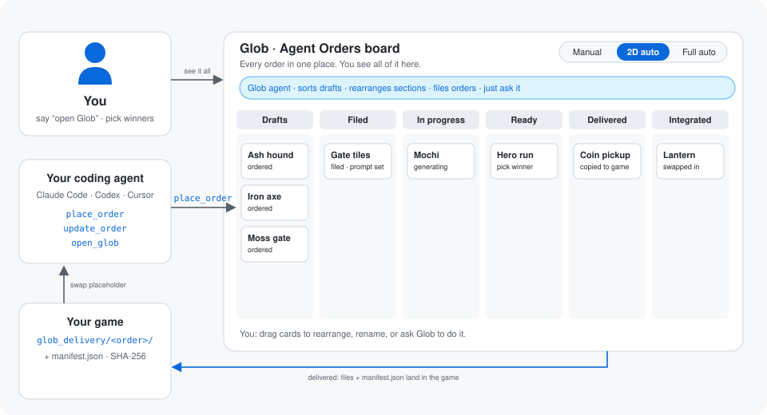

<div align="center">


# Glob

### Tell your coding agent *"open Glob"*. That's it.

Glob opens in your browser, on the game your agent is building.<br>
The agent orders the art it needs; Glob forges 2D art, 3D models, rigs, animations, icons and sounds<br>
and drops the finished files straight into your game.

**New here?** Paste this into your coding agent, from your game's folder:

```text
Set up Glob for this game: read https://soulnassim.github.io/Glob-Game-Forge/agent.md
```

[**Get started**](#get-started) · [**▶ Live demo**](https://soulnassim.github.io/Glob-Game-Forge/demo/) · [Website](https://soulnassim.github.io/Glob-Game-Forge/) · [Generation modes](#generation-modes)

**Free and open source (MIT).** Bring keys for the generators you use. No markup, no subscription.

</div>

<p align="center"></p>

## Just say "open Glob"

Connect your game once (your agent does it with `glob connect`). After that you never start Glob yourself: say **"open Glob"** to your agent (Claude Code, Codex, Cursor, Copilot, OpenCode, Gemini CLI), or just let it order its first asset. Glob starts on this computer and opens on the project your agent is working on, with every order, prompt, image, model and sound in one place.

- **No app to keep open.** Glob runs on `localhost` while you need it. *Settings → Storage & access → Stop Glob* ends it.
- **Rather start it yourself?** Run `glob`, and set `FORGE_NO_AUTOSTART=1` for your agent.


<p align="center"><b>Pocket Kaiju</b>: a sample game made entirely in Glob, with 16 assets, 3D models and sounds.<br>
<a href="https://soulnassim.github.io/Glob-Game-Forge/demo/"><b>▶ Click through it in the live demo</b></a>: the real app in your browser, read-only, no keys needed.</p>

## Generation modes

How far Glob goes on its own when your agent orders something. Pick it per project at the top of the **Agent Orders** board.

| Mode | When an order comes in | You do |
|---|---|---|
| **Manual** | Glob files it as an asset page with its prompt, then asks: *"Generate the 2D images now?"* **Yes / No** | Press Generate, pick a winner, make 3D |
| **2D auto** | Also generates 2D candidates right away | Pick the winner, then make 3D |
| **Full auto** | Makes everything the order's kind needs: candidates, picks the first as winner, then the 3D model (or the sound) | Review, swap the winner if you like |

The auto modes have a **spend cap** per project ($5 to start). They pause once they reach it, so an agent ordering 40 props overnight can't run up a bill. Every step runs once per order; a failed step waits for you instead of retrying. You can still switch off **File new orders on their own**; drafts then wait until you or the Glob chat sort them.

## What you can make

| | |
|---|---|
| 🎨 **2D art** | Characters, items, environments, UI, VFX. A **style bible** and reference **pillars** go into every prompt, per folder, so everything matches |
| 🧊 **3D models** | From the winner image, with poly count, game height, a 3D lineup next to a 1.7 m person, and OBJ / STL / USDZ export |
| 🦴 **Rigs and animations** | Rig a model and add animations from a library |
| 🔊 **Sounds** | Sound effects, voices and music, with a real waveform, trimming and a loop check |
| 🗂️ **Game icons** | Turn any image into square, transparent inventory icons (32 to 512 px) in one click |
| ✂️ **Sprites and parts** | Cut a sheet into parts or new assets, render sprite sheets from a 3D model |
| 📦 **Press kit** | One ZIP with a web page of your key art, winners, turning 3D models and sounds |

<table>
<tr>
<td><br><sub>An asset: winner, prompt and what to do next.</sub></td>
<td><br><sub>Model, price and the exact prompt before anything is sent.</sub></td>
</tr>
<tr>
<td><br><sub>3D viewer with poly count, game height and export.</sub></td>
<td><br><sub>The board: every asset on one canvas.</sub></td>
</tr>
<tr>
<td><br><sub>Sounds with a waveform you can trim and loop-check.</sub></td>
<td><br><sub>Every project with its key art.</sub></td>
</tr>
</table>

## Get started

### 1. Tell your agent

Paste this into your coding agent (Claude Code, Codex, Cursor, Copilot, OpenCode, Gemini CLI), from your game's folder:

```text
Set up Glob for this game: read https://soulnassim.github.io/Glob-Game-Forge/agent.md
```

Your agent follows [`docs/agent.md`](docs/agent.md): it installs Glob with [uv](https://docs.astral.sh/uv/) and runs `glob connect` in your game folder, which

- makes the game's Glob project (in `<game>/glob/`), or finds the one made before;
- connects your coding agents to it (the MCP server `glob`, a note in `AGENTS.md`, a `glob` skill);
- starts Glob in the background and opens it in your browser on your game.

### 2. Finish setup in the browser

A short setup asks for generator keys (one is enough; without any, Glob makes placeholder files so you can try the whole flow). Keys go into Glob's own page and stay on your computer; they never pass through the agent's chat. Then restart your agent and approve the `glob` MCP server so it loads Glob's tools.

<details>
<summary><b>Rather do it yourself?</b> Install, then <code>glob connect</code></summary>

```powershell
# Windows (PowerShell)
irm https://raw.githubusercontent.com/SoulNassim/Glob-Game-Forge/main/scripts/install.ps1 | iex
```

```bash
# macOS / Linux
curl -LsSf https://raw.githubusercontent.com/SoulNassim/Glob-Game-Forge/main/scripts/install.sh | sh
```

Then, in a new terminal, in your game folder:

| Command | What it does |
|---|---|
| `glob connect` | Makes or finds this game's Glob project, connects its coding agents and opens Glob on it. `--agents claude,codex` picks the agents. |
| `glob open` | Opens Glob on this game's project, starting it in the background if needed. |
| `glob` | Runs Glob in this terminal and opens <http://127.0.0.1:8420>. |

You can also connect from inside Glob: **Settings → Coding agent**. Projects are listed in `~/Glob/projects` (a source checkout uses its own `projects/`); a project made for a game keeps its files in that game's `glob/` folder.

From source, with Python 3.11+ and [uv](https://docs.astral.sh/uv/):

```bash
git clone https://github.com/SoulNassim/Glob-Game-Forge.git
cd Glob-Game-Forge
uv run forge
```

The desktop app (`glob-desktop`, or the installers on the [releases page](https://github.com/SoulNassim/Glob-Game-Forge/releases)) still works, but you don't need it: Glob is made for the browser.

</details>

<details>
<summary>What connecting writes into your game folder (and removes again on Disconnect)</summary>

- The `glob` MCP server entry for each chosen agent: `.mcp.json`, `.codex/config.toml`, `.cursor/mcp.json`, `.vscode/mcp.json`, `opencode.json` or `.gemini/settings.json`.
- A short note between `<!-- glob:start -->` and `<!-- glob:end -->` in `AGENTS.md`, `CLAUDE.md` and `GEMINI.md`.
- A `glob` skill in `.claude/skills/glob/` and `.agents/skills/glob/`.
- `glob_delivery/README.md`.

The agent starts the MCP server itself (`python -m forge.cli --mcp --project <name>`). It forwards to the running studio, so jobs and live updates show up there, and starts the studio when it isn't running (`open_glob`, or the first order or generation). `FORGE_NO_AUTOSTART=1` turns the automatic start off.

</details>

### 3. Build your game

Ask your agent for something that needs art:

> *"Add three enemy types with placeholder models and order the real ones from Glob."*

Glob opens in your browser on that project (or say *"open Glob"* any time), and the orders show up on the **Agent Orders** board. Depending on the [generation mode](#generation-modes), you generate and pick, or watch Glob do it. Finished files land in `<game>/glob_delivery/`, and the agent swaps its placeholders.

Already have a game? **Projects → Import game** takes a Godot, Unity or Unreal project, or any folder of art.

## Agent Orders and delivery

```
draft → filed → in_progress → ready → delivered → integrated   (or cancelled)
```

- **draft:** ordered, not in the workspace yet. New orders are filed on their own into the matching section (`agent-orders/` when nothing fits). Ask the Glob chat to move or regroup them any time.
- **filed:** an asset page with a prompt. **in_progress / ready** are worked out live from the files.
- **delivered:** copied to `<game>/glob_delivery/<order_id>/`, every file listed in `glob_delivery/manifest.json` with its SHA-256. Glob never writes anywhere else in your game.
- **integrated:** the agent swapped its placeholder and called `update_order status=integrated`.

| Kind | Ready when it has |
|---|---|
| character, creature, item, weapon, prop, vehicle | image + 3D model |
| environment, ui, vfx | image |
| sfx, voice, music | audio |

You can change what an order needs (add a rig or animations) per order.

## More

<details>
<summary><b>Generators</b></summary>

**Settings → Generators.** Keys stay on this computer. You pay the providers directly.

| Generator | Makes |
|---|---|
| Google Gemini | Images |
| Meshy | 3D models, rigging, animation |
| Tripo | 3D models (alternative; pick it under "3D generator") |
| ElevenLabs | Sound effects, voices, music, more image models (sign in, or paste a key) |
| Stability AI | Music and loops (Stable Audio) |

Sound takes live in `<asset>/audio/`. For a voice, the prompt is the line to speak. Drop an MP3/WAV on an asset to add a take. A generator that isn't set up is refused with a message; it never saves a silent placeholder.

</details>

<details>
<summary><b>Import a game</b></summary>

**Projects → Import game** (or tell the Glob chat where your game is) scans a **Godot, Unity or Unreal** project, or any folder of game art, then shows a review step: untick sections, leave assets out, rename or merge sections, and optionally put "needs art" entries into Agent Orders.

You get characters with their models, animations and textures, weapons, items and enemies with stats, kits, skies, texture packs, concept art, audio and design docs. Files are copied; your game folder is never changed.

</details>

<details>
<summary><b>Projects, workspaces and storage</b></summary>

- **Projects are folders.** Top-level folders are sections, `README.md` files are pages, and any `.md` with `kind:` and `prompt:` in its header is an asset. Readable, diffable and yours.
- **Export / import a workspace:** the download icon on a project card saves it as a `.zip`; **Projects → Import workspace** (or dropping the file on the projects page) brings it in on another computer.
- **Storage:** Settings → Storage & access shows the projects folder (change it there) and opens each project's folder.
- **Folder access:** Glob only sees its projects folder until you allow more, read or read & write. Keys, `.env` and key files are always off-limits.

</details>

<details>
<summary><b>All the small things</b></summary>

- **Style that sticks.** Images in `pillars/` and rules in `pillars/*.md` stack from the project root down. Any image becomes a pillar from its ⋯ menu. Pillar strength per asset: off, light, normal or strong.
- **Pick fast.** Click a candidate (or press `1`–`9`) to see it big; `←` `→` to step, `Enter` to pick the winner.
- **Generate all missing.** Candidates for every asset that has nothing to pick from yet, two at a time, with a cost estimate first.
- **Board.** Every asset on one zoomable canvas, grouped by section. **3D lineup** stands every model at its game height.
- **Credits first.** The generate sheet warns when a provider ran out of credits and shows Meshy's balance.
- **Live workspace.** Edits from your agent show up at once.
- **⌘K / Ctrl+K** jumps to any asset or action. **G** toggles gallery mode.
- **Make key art** paints a project cover from its pitch.

</details>

<details>
<summary><b>Workspace conventions</b></summary>

| In the workspace folder | What Glob does with it |
|---|---|
| Top-level folder, e.g. `02-characters/` | A section; the number sets its order and is hidden in the title |
| `README.md` in a folder | That folder's page; its `# Heading` is the title, the first paragraph the summary |
| Root `README.md` (or `GAME.md`) | The project's front page |
| `cover.png` / `.jpg` / `.webp` | Hero image of its folder (at the root: the project's key art) |
| `.md` with `kind:` and `prompt:` in its header | An asset. Kinds: character, creature, item, weapon, prop, environment, vehicle, ui, vfx, sfx, voice, music |
| `pillars/*.png` (root = project bible) | Reference images sent with every generation at or below that folder |
| `pillars/*.md` | Style-bible text added in front of every prompt at or below that folder |
| `pillars:` / `aspect:` / `height_m:` in an asset header | Pillar strength, framing (`16:9`…) and height in metres |
| `cover: true` in an asset header | Its winner becomes the project cover |
| `ORDERS.json`, `ORDER_MODE.json` | Agent orders and the project's generation mode |

Generated files are saved next to the asset (`<asset>/candidates|variants|edits|3d/`) and in the project vault with a JSON record of the exact prompt, images and model used.

</details>

<details>
<summary><b>Glob chat</b></summary>

Glob can also run as a chat next to your project, on any model: Anthropic, OpenAI, OpenRouter, Gemini, Ollama, LM Studio, a custom OpenAI-compatible URL, or models imported from VS Code Copilot. Ask it to sort drafts, regroup sections, rewrite prompts or generate. **Settings → Glob chat:** *Automatic* hides it while a coding agent is connected.

</details>

<details>
<summary><b>MCP tools</b></summary>

Over stdio (`uv run forge --mcp --project <name>`) and HTTP JSON-RPC (`POST http://127.0.0.1:8420/api/mcp`), plus an MCP prompt `glob` and server `instructions`.

| Task | Tools |
|---|---|
| Show the studio | `open_glob` |
| Order and track assets | `place_order`, `list_orders`, `get_order`, `file_order`, `update_order` |
| Deliveries | `get_deliveries`, `deliver_order` |
| Read and shape the workspace | `workspace_overview`, `workspace_list`, `workspace_read`, `workspace_write`, `workspace_create_folder`, `workspace_move`, `workspace_delete` |
| Make assets | `generate`, `pick_winner` |
| Costs and queue | `get_budget`, `queue_status` |
| Existing game | `find_placeholders`, `scan_game_project`, `import_game` |

</details>

<details>
<summary><b>Keys, costs and security</b></summary>

Glob itself is free; generation runs on your provider accounts, and the send screen shows the price first.

- Keys are saved in `~/.forge/config.json` (owner-only on macOS/Linux), masked in every API response, and never go into a project or export. They can also come from `GEMINI_API_KEY`, `MESHY_API_KEY`, `TRIPO_API_KEY`, `ELEVENLABS_API_KEY`, `STABILITY_API_KEY`, `ANTHROPIC_API_KEY` and `OPENAI_API_KEY`.
- Glob listens on **127.0.0.1** only. `--host` elsewhere prints a warning, because anyone who reaches the port can use your keys.
- Requests from other websites (CSRF) and DNS-rebinding hosts are refused; MCP clients and scripts still work.
- Server settings (`host`, `port`, `allowed_proxy_hosts`) and folder grants can't be changed over HTTP. The asset proxy only fetches from provider hosts.

Found a problem? Please open a private [security advisory](https://github.com/SoulNassim/Glob-Game-Forge/security/advisories/new).

</details>

<details>
<summary><b>Development</b></summary>

```bash
uv run --extra dev pytest -v                 # tests
uv run forge --port 8421 --no-browser        # another port, no browser tab
uv run forge --mcp --project <name>          # MCP server over stdio
uv run --extra desktop forge --desktop       # native window
uv run --extra desktop --with pyinstaller python scripts/build_desktop.py   # standalone app
```

| Path | What's there |
|---|---|
| `forge/server/` | FastAPI app and the local-only request guard |
| `forge/agent/` | Glob chat, model endpoints, `connect.py` (game folder link), `glob_prompt.md` |
| `forge/orders.py`, `forge/order_mode.py` | Agent Orders, delivery and the generation modes |
| `forge/launcher.py` | Starting Glob for a coding agent (`open_glob`, auto-start) |
| `forge/providers/` | Gemini, Meshy, Tripo, ElevenLabs and Stability clients |
| `forge/mcp/` | MCP server (stdio, forwards to the app when it runs) |
| `forge/game_import.py` | Importing Godot / Unity / Unreal projects |
| `forge/ui/` | The web UI (plain HTML/CSS/JS) |
| `docs/` | Website, live demo (`docs/demo/`, rebuild with `scripts/build_demo.py`), screenshots and diagrams |

Pushing a tag like `v1.0.0` runs [`.github/workflows/release.yml`](.github/workflows/release.yml), which builds the Windows installer and the macOS `.dmg` and attaches them to a GitHub release. The Python package is still called `forge`; `forge` and `glob` are the same command.

</details>

## License

[MIT](LICENSE). Use it, fork it, ship games with it.
