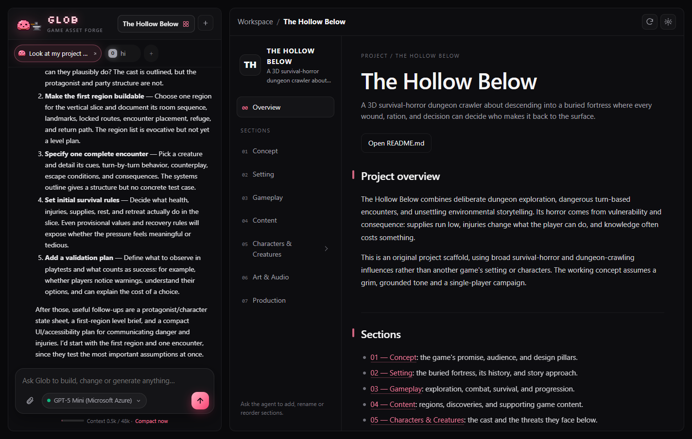
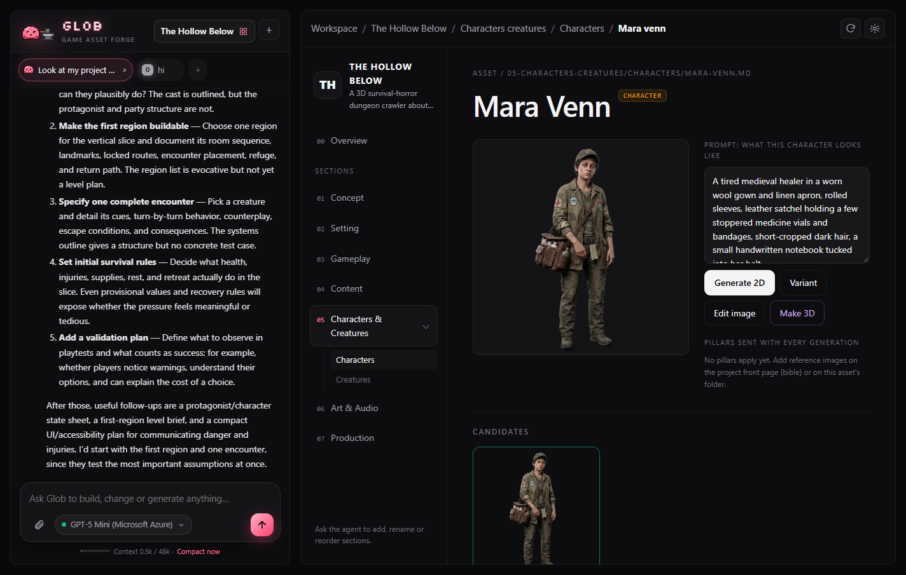
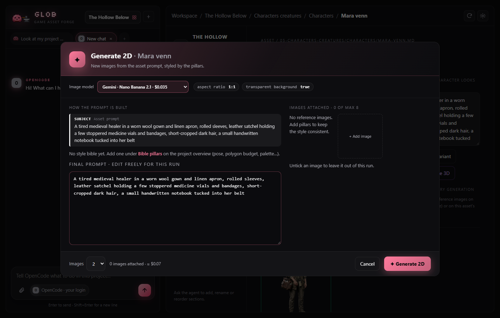

<div align="center">


# Glob

**Your game’s art, forged locally.**

Describe your game. Glob builds the project, keeps every asset organized,<br>
and turns prompts into consistent 2D art and real 3D models, on your own machine.

**Free and open source (MIT).** You only bring API keys for the image and 3D providers you use.

[**Website**](https://soulnassim.github.io/Glob-Game-Forge/) · [Download](#install) · [Desktop app](#desktop-app) · [For coding agents](#for-coding-agents) · [Security](#security)

</div>



## Why Glob

Making the game is fun. Making the art is usually chaos:

| Without Glob | With Glob |
|---|---|
| Prompts scattered over 50 browser tabs | Every asset is a Markdown file with its prompt, in your project folder |
| Every image in a different style | A **style bible** and reference **pillars** go into every prompt, per folder |
| No idea what a run will cost | The send screen shows model, price, final prompt and attached images first |
| Your coding agent leaves grey placeholder cubes | Your agent requests assets over **MCP**; Glob delivers them with a SHA-256 receipt |

## How it works

1. **Describe your game.** Answer three questions; Glob writes a style bible and designs sections, pages and the first assets.
2. **Generate 2D.** Get candidates from Gemini (Nano Banana), GPT Image, Seedream or Meshy, with your style in every prompt.
3. **Pick a winner.** Keep the best one, make a variant, edit it, or drop in your own art.
4. **Make 3D.** One click to a textured GLB, ready for Godot, Unity or Unreal.

<table><tr>
<td></td>
<td></td>
</tr></table>

## Install

**Download the app** (no Python needed):

| | |
|---|---|
| Windows 10/11 | [**Glob-Setup-Windows.exe**](https://github.com/SoulNassim/Glob-Game-Forge/releases/latest/download/Glob-Setup-Windows.exe) |
| macOS (Apple silicon) | [**Glob-macOS.dmg**](https://github.com/SoulNassim/Glob-Game-Forge/releases/latest/download/Glob-macOS.dmg) |

The apps aren’t code-signed yet: on first launch, Windows may show SmartScreen (*More info → Run anyway*) and macOS wants *right-click → Open*.

**Or install from the terminal** (installs [uv](https://docs.astral.sh/uv/) if needed, then Glob):

```powershell
# Windows (PowerShell)
irm https://raw.githubusercontent.com/SoulNassim/Glob-Game-Forge/main/scripts/install.ps1 | iex
```

```bash
# macOS / Linux
curl -LsSf https://raw.githubusercontent.com/SoulNassim/Glob-Game-Forge/main/scripts/install.sh | sh
```

Then run `glob-desktop` (app window) or `glob` (browser).

**Or run from source** with **Python 3.11+** and [**uv**](https://docs.astral.sh/uv/):

```bash
git clone https://github.com/SoulNassim/Glob-Game-Forge.git
cd Glob-Game-Forge
uv run forge
```

Glob opens at <http://127.0.0.1:8420>. Then:

1. **Connect a brain:** Settings (gear icon) → AI models. Pick a provider or import your VS Code models.
2. **Connect image and 3D:** Settings → Image & 3D. Paste a Gemini, Meshy and/or ElevenLabs key.
3. **Make a project:** press **+** next to the project name and follow the onboarding.

No keys yet? Glob runs in **Demo Mode**, so you can try everything for free.

## Desktop app

Run Glob in its own native window (WebView2 on Windows, WebKit on macOS, GTK/Qt on Linux) instead of a browser tab:

```bash
uv run --extra desktop forge --desktop
```

To build a standalone app that runs without Python (`dist/Glob/Glob.exe` on Windows, `Glob.app` on macOS):

```bash
uv run --extra desktop --with pyinstaller python scripts/build_desktop.py
```

The standalone app keeps projects in `~/Glob/projects` and settings in `~/.forge`.

Pushing a tag like `v1.0.0` runs [`.github/workflows/release.yml`](.github/workflows/release.yml), which builds the Windows installer (Inno Setup, [`packaging/windows/glob.iss`](packaging/windows/glob.iss)) and the macOS `.dmg` and attaches them to a GitHub release. The download links above always point at the latest release.

## Features

- **Projects are folders.** Top-level folders are sections, `README.md` files are pages, and any `.md` with `kind:` and `prompt:` in its header is an asset. Everything is readable, diffable and yours.
- **Style that sticks.** Images in `pillars/` and rules in `pillars/*.md` stack from the project root down, so characters, items and UI can each have their own look. Any image can become a pillar with **✦ Make pillar**.
- **Any chat model.** Anthropic, OpenAI, OpenRouter, Google Gemini, Ollama, LM Studio or any OpenAI-compatible URL, with model and reasoning effort switchable under the chat box.
- **Coding agents as tabs.** Claude Code, Codex, OpenCode and Gemini CLI run inside the project folder with your own login. Several can run at once.
- **Long chats stay fast.** Auto-compact folds older messages into a summary at the size you choose.
- **Many projects.** The projects page shows every game with its latest art; deleted projects go to `projects/.trash/`.

<details>
<summary><b>Workspace conventions</b></summary>

| In the workspace folder | What Glob does with it |
|---|---|
| Top-level folder, e.g. `02-characters/` | A section; the number sets its order and is hidden in the title |
| `README.md` in a folder | That folder’s page; its `# Heading` is the title, the first paragraph the summary |
| Root `README.md` (or `GAME.md`) | The project’s front page |
| `cover.png` / `.jpg` / `.webp` | Hero image of its folder |
| `.md` with `kind:` and `prompt:` in its header | An asset. Kinds: character, creature, item, weapon, prop, environment, vehicle, ui, vfx |
| `pillars/*.png` (root = project bible) | Reference images sent with every generation at or below that folder |
| `pillars/*.md` | Style-bible text added in front of every prompt at or below that folder |
| `style:` in a folder README header | A one-line style rule, inherited the same way |

Generated files are saved next to the asset (`<asset>/candidates|variants|edits|3d/`) and in the project vault (`projects/<name>/vault/`) with a JSON record of the exact prompt, images and model used.

</details>

## For coding agents

Glob is an MCP server, so an agent writing your game can read the project, request assets and get delivery receipts. The repo ships a [`.mcp.json`](.mcp.json):

```json
{ "mcpServers": { "forge": { "command": "uv", "args": ["run", "forge", "--mcp"] } } }
```

An agent adds a requirement instead of a placeholder:

```markdown
- [ ] `ashen_board` | **3D Mesh** | `res://assets/models/ashen_board.glb` | An iron-bound stone chessboard with a clear 8×8 grid.
```

Glob fulfills it, ticks it `[x]` and records the asset ID and SHA-256 receipt in `DELIVERY_MANIFEST.json`. Use `writeback_preview` before `writeback_apply` when writing into a Godot, Unity or Unreal project.

| Agent task | Tools |
|---|---|
| Read/write shared project docs | `read_workspace_doc`, `write_workspace_doc` |
| Plan and track assets | `list_asset_requirements`, `add_asset_requirement`, `fulfill_asset_requirements` |
| Leave a durable handoff | `post_agent_handoff` |
| Inspect an existing game | `scan_game_project`, `get_game_profile`, `list_asset_wishlist`, `find_placeholders`, `propose_assets_for` |
| Write into the engine project | `writeback_preview`, `writeback_apply` |
| Produce and export assets | `list_assets`, `get_asset`, `run_verb`, `run_recipe`, `get_budget`, `queue_status`, `export` |

The same tools are available over HTTP JSON-RPC at `POST http://127.0.0.1:8420/api/mcp` (list them at `GET /api/mcp/tools`). The full protocol is in [AGENTS.md](AGENTS.md) and the [asset pipeline skill](.agents/skills/forge-asset-maker/SKILL.md).

## Providers, keys and costs

Glob itself is free. Image and 3D generation run on your own provider accounts, so you pay them directly, with no markup and no subscription. Demo Mode needs no keys at all.

- **Chat:** any model added in Settings → AI models, or `ANTHROPIC_API_KEY` / `OPENAI_API_KEY`.
- **Images:** Gemini (Nano Banana), Meshy image models, or ElevenLabs (GPT Image, Seedream, Nano Banana). Pick the model per run on the send screen.
- **3D:** Meshy.

Keys can also come from `GEMINI_API_KEY`, `MESHY_API_KEY` and `ELEVENLABS_API_KEY`. Provider calls cost money; the send screen shows the price per image before anything runs.

## Security

Glob is a local tool with no login, so it is built to stay local:

- It listens on **127.0.0.1** only. Binding elsewhere (`--host`) prints a warning, because anyone who can reach the port can use your keys and agents.
- Every API and WebSocket request must come from Glob itself: requests from other websites (CSRF) and DNS-rebinding hosts are refused. MCP clients and scripts without a browser origin still work.
- API keys and OAuth tokens live in `~/.forge/` (owner-only permissions on macOS/Linux), are masked in every API response, and never go into a project folder or export.
- Server-level settings (`host`, `port`, `allowed_proxy_hosts`) cannot be changed over HTTP.
- The asset proxy only fetches from an allow-list of provider hosts.

Found a problem? Please open a private [security advisory](https://github.com/SoulNassim/Glob-Game-Forge/security/advisories/new) rather than a public issue.

## Development

```bash
uv run --extra dev pytest -v        # tests
uv run forge --port 8421            # another port
uv run forge --no-browser           # don't open a browser tab
```

| Path | What’s there |
|---|---|
| `forge/server/` | FastAPI app, terminal bridge and the local-only request guard |
| `forge/agent/` | Glob’s chat agent, model endpoints and coding-agent tabs |
| `forge/providers/` | Gemini, Meshy and ElevenLabs clients |
| `forge/mcp/` | MCP server (stdio and HTTP) |
| `forge/ui/` | The web UI (plain HTML/CSS/JS) |
| `docs/` | Website (`docs/index.html`) and screenshots |
| `sample_godot_game/` | A tiny Godot project for trying engine write-back |
| `tools/make_glob_mascot.py` | Glob’s pixel art and app icon; edit the grids and rerun |

The website is a static page in `docs/`; publish it with GitHub Pages (Settings → Pages → Deploy from branch → `main` / `docs`).

> The Python package is still called `forge`; `forge` and `glob` are the same command.

## License

[MIT](LICENSE). Use it, fork it, ship games with it.
