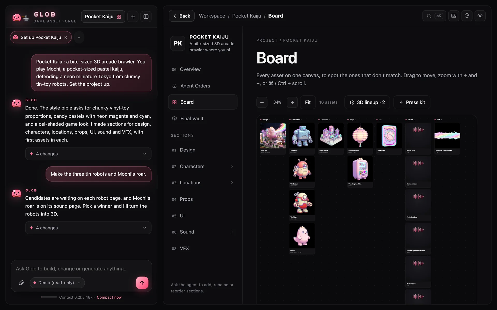

<div align="center">


# Glob

**Your game's asset studio.**

Your coding agent stays where it is: it orders, Glob delivers.<br>
Glob makes the 2D art, 3D models, rigs, animations and sounds, and puts them in your game folder.

**Free and open source (MIT).** You only bring API keys for the generators you use.

[**Website**](https://soulnassim.github.io/Glob-Game-Forge/) · [**Live demo**](https://soulnassim.github.io/Glob-Game-Forge/demo/) · [Download](#install) · [Connect your agent](#connect-your-coding-agent) · [Desktop app](#desktop-app) · [Security](#security)

</div>


<p align="center"><b>Pocket Kaiju</b>, a sample game made entirely in Glob: 16 assets, 3D models and sounds.<br>
<a href="https://soulnassim.github.io/Glob-Game-Forge/demo/"><b>▶ Click through it in the live demo</b></a> (the real app in your browser, read-only, no keys) or open it in Glob with <i>Explore a finished project</i>.</p>

## Why Glob

Making the game is fun. Making the art is usually chaos:

| Without Glob | With Glob |
|---|---|
| Your coding agent leaves grey placeholder cubes | It orders the real asset, Glob delivers it with a SHA-256 manifest |
| Prompts scattered over 50 browser tabs | Every asset is a Markdown file with its prompt, in your project folder |
| Every image in a different style | A **style bible** and reference **pillars** go into every prompt, per folder |
| No idea what a run will cost | The send screen shows model, price and final prompt first; a budget card tracks spend per project |

## How it works

1. **Code your game with any agent.** Claude Code, Codex, Cursor, VS Code/Copilot, OpenCode or Gemini CLI. It uses placeholders and orders the real art.
2. **Connect the game once.** Settings → Coding agent. The agent now knows about Glob. You never have to say "use Glob".
3. **Glob delivers.** You shape the assets in the app. Finished files land in `glob_delivery/` in your game. The agent swaps its placeholder.

```text
 your coding agent                 Glob                          your game
 -----------------                 ----                          ---------
 place_order  ───────────────▶  Agent Orders board
                                 file, generate, pick winner
                                 order is ready  ───────────▶  glob_delivery/<order>/
 swap placeholder  ◀───────────────────────────────────────────  + manifest.json (SHA-256)
 update_order status=integrated ─▶  integrated
```

<table>
<tr>
<td><br><sub>An asset: winner, prompt and what to do next.</sub></td>
<td><br><sub>Model, price and the exact prompt before anything is sent.</sub></td>
</tr>
<tr>
<td><br><sub>3D viewer with poly count, game height and export.</sub></td>
<td><br><sub>The board: every asset on one canvas.</sub></td>
</tr>
<tr>
<td><br><sub>Sounds with a waveform you can trim and loop-check.</sub></td>
<td><br><sub>Every project with its key art.</sub></td>
</tr>
</table>

## Install

**Download the app** (no Python needed):

| | |
|---|---|
| Windows 10/11 | [**Glob-Setup-Windows.exe**](https://github.com/SoulNassim/Glob-Game-Forge/releases/latest/download/Glob-Setup-Windows.exe) |
| macOS (Apple silicon) | [**Glob-macOS.dmg**](https://github.com/SoulNassim/Glob-Game-Forge/releases/latest/download/Glob-macOS.dmg) |

Glob checks for new releases when it starts and shows **Update now**: the Windows and macOS apps download the new version, install it and restart by themselves, and terminal installs update with `uv`. Turn the check off in Settings → Storage & access → Updates.

The apps aren’t code-signed yet: on first launch, Windows may show SmartScreen (*More info → Run anyway*) and macOS wants *right-click → Open*.

**Or install from the terminal** (installs [uv](https://docs.astral.sh/uv/) if needed, then Glob):

```powershell
# Windows (PowerShell)
irm https://raw.githubusercontent.com/SoulNassim/Glob-Game-Forge/main/scripts/install.ps1 | iex
```

```bash
# macOS / Linux
curl -LsSf https://raw.githubusercontent.com/SoulNassim/Glob-Game-Forge/main/scripts/install.sh | sh
```

Then run `glob-desktop` (app window) or `glob` (browser).

**Or run from source** with **Python 3.11+** and [**uv**](https://docs.astral.sh/uv/):

```bash
git clone https://github.com/SoulNassim/Glob-Game-Forge.git
cd Glob-Game-Forge
uv run forge
```

Glob opens at <http://127.0.0.1:8420>. On first launch a short setup walks you through three optional steps (**Settings → Storage & access → Run first-time setup again** brings it back):

1. **Generators:** paste keys for Gemini, Meshy, Tripo, ElevenLabs and/or Stability AI. One key is enough to start.
2. **Coding agent:** connect your game folder.
3. **Glob chat:** optional, connect a chat model.

Then start a new project, or **import the game you already have**. Without keys, Glob makes simple placeholder files, so you can try the whole flow first.

## Connect your coding agent

**Settings → Coding agent.** Pick the game folder and the agents you use there. Glob writes only its own part:

- The `glob` MCP server entry in each chosen agent's config: `.mcp.json`, `.codex/config.toml`, `.cursor/mcp.json`, `.vscode/mcp.json`, `opencode.json` or `.gemini/settings.json`.
- A short note between `<!-- glob:start -->` and `<!-- glob:end -->` in `AGENTS.md`, `CLAUDE.md` and `GEMINI.md`.
- A `glob` skill in `.claude/skills/glob/` and `.agents/skills/glob/`.
- `glob_delivery/README.md`.

Disconnect removes all of it again. Restart your agent after connecting so it loads the MCP server.

The MCP server is started by the agent (`python -m forge.cli --mcp --project <name>`). When the Glob app is running, it forwards to the app, so jobs and live updates show up there. When the app is closed, it works on the files directly, and generation asks you to open the app.

## Agent Orders and delivery

The agent orders with `place_order`: title, kind, brief, placeholder path, context and needs. Orders show up in the **Agent Orders** board.

`draft` → `filed` → `in_progress` → `ready` → `delivered` → `integrated` (or `cancelled`)

- **draft:** ordered, not in the workspace yet.
- **filed:** sorted into the workspace with a real prompt. Open a second session and let the agent load the `glob` skill (`file_order`), let the Glob chat do it, or click **File into…**.
- **in_progress / ready:** worked out live from the workspace files.
- **delivered:** copied to the game.
- **integrated:** the agent swapped its placeholder and called `update_order status=integrated`.

An order is **ready** when it has what its kind needs. You can override this per order, including rig and animations.

| Kind | Ready when it has |
|---|---|
| character, creature, item, weapon, prop, vehicle | image + 3D model |
| environment, ui, vfx | image |
| sfx, voice, music | audio |

Ready orders are copied automatically (toggle in Settings → Coding agent) to `<game>/glob_delivery/<order_id>/`: `<id>.png`, `<id>.glb` (plus other formats), `animations/`, `<id>.mp3`. `glob_delivery/manifest.json` lists every file with its SHA-256. Glob never writes anywhere else in your game. If an asset changes, it is delivered again.

## Generators

**Settings → Generators.** Keys stay on this computer. You pay the providers directly.

| Generator | Makes |
|---|---|
| Google Gemini | Images |
| Meshy | 3D models, rigging, animation |
| Tripo | 3D models (alternative; pick it under "3D generator") |
| ElevenLabs | Sound effects, voices, music, more image models (sign in, or paste a key) |
| Stability AI | Music and loops (Stable Audio) |

**Sound assets** have kinds `sfx`, `voice` and `music`. Takes live in `<asset>/audio/`. The prompt is the description; for a voice it is the line to speak. When you are signed in to ElevenLabs, sounds, voices and music run on that account first. Pick a voice (Glob remembers it per asset), or drop an MP3/WAV on the asset to add a take. A generator that isn't set up is refused with a message; it never saves a silent placeholder.

## Import your game

**Projects → Import game** (or tell the Glob chat where your game is) takes a **Godot, Unity or Unreal** project, or any folder of game art. It scans first, then shows a review step:

- Untick sections, or click assets to leave them out.
- Rename sections or merge them.
- Optionally put "needs art" entries into Agent Orders.

Then import. You get characters with their models, animations and textures, weapons, items and enemies with stats, kits, skies, texture packs, concept art, audio and design docs. Previews of every model are rendered.

Files are copied into the project; your game folder is never changed. Glob's own folders (`glob_delivery`, agent config dirs) are skipped. Importing into an existing project merges into sections and assets with the same name.

## Where your projects live

**Settings → Storage & access** shows the projects folder (change it there) and each project's folder on disk, with buttons to open them.

- **Export / import:** export a project as a `.zip` (download icon on its card, or in Settings) and import it on another computer with **Projects → Import .zip** or by dropping the file on the projects page.
- **Folder access:** Glob only sees its projects folder until you allow more. Grant a folder in Settings, during setup, or with **Allow** when Glob asks in the chat; choose read or read & write. Keys, `.env` and key files are always off-limits.
- **Images in the chat:** drag them onto the chat, paste them, or use the paperclip.

## Desktop app

Run Glob in its own native window (WebView2 on Windows, WebKit on macOS, GTK/Qt on Linux) instead of a browser tab:

```bash
uv run --extra desktop forge --desktop
```

To build a standalone app that runs without Python (`dist/Glob/Glob.exe` on Windows, `Glob.app` on macOS):

```bash
uv run --extra desktop --with pyinstaller python scripts/build_desktop.py
```

The standalone app keeps projects in `~/Glob/projects` and settings in `~/.forge`.

Pushing a tag like `v1.0.0` runs [`.github/workflows/release.yml`](.github/workflows/release.yml), which builds the Windows installer (Inno Setup, [`packaging/windows/glob.iss`](packaging/windows/glob.iss)) and the macOS `.dmg` and attaches them to a GitHub release. The download links above always point at the latest release.

## Features

- **Projects are folders.** Top-level folders are sections, `README.md` files are pages, and any `.md` with `kind:` and `prompt:` in its header is an asset. Everything is readable, diffable and yours.
- **Style that sticks.** Images in `pillars/` and rules in `pillars/*.md` stack from the project root down, so characters, items and UI can each have their own look. Any image can become a pillar with **✦ Make pillar**.
- **Live workspace.** The app updates when files change on disk, so edits from your agent show up at once.
- **Long chats stay fast.** Auto-compact folds older messages into a summary at the size you choose.
- **Many projects.** The projects page shows every game with its key art (or its latest images); deleted projects go to `projects/.trash/`. **Make key art** paints a cover from the project's pitch; pick another candidate on its page to change it.
- **A finished sample.** *Explore a finished project* (on the projects page, the first onboarding step and an empty project) opens **Pocket Kaiju**: characters, 3D models, sounds and an agent order to click through, without spending credits.
- **Board.** Every asset of the project on one zoomable canvas, grouped by section, to spot what doesn't match. **3D lineup** stands every model side by side at its height in the game (set it in the 3D viewer) next to a 1.7 m person.
- **Generate all missing.** On the overview or any folder: candidates for every asset that has nothing to pick from yet, two at a time, with a cost estimate first. Running and waiting jobs show bottom right.
- **Pick fast.** Click a candidate (or press `1`–`9`) to see it big; `←` `→` to step, `Enter` to pick the winner. Each image remembers the prompt it came from, with **Use this prompt again**.
- **Pillar strength per asset:** off, light (palette only), normal or strong, so a prop doesn't copy the hero's crest. Each kind opens with a fitting framing (VFX and environments 16:9, UI 3:4); the sheet remembers what you pick.
- **Credits first.** The generate sheet warns when a provider said "out of credits" lately and shows Meshy's balance when a key is set.
- **3D viewer extras:** file size, dimensions, height in the game, and OBJ / STL / USDZ downloads converted in the browser.
- **Sound tools:** the real waveform of the winner take; drag to select and **Save selection** as a new take; **Loop check** plays the end into the start. Sound effects come in pools of up to six variations.
- **Hover previews.** Sounds play and 3D models turn when you hover their tile.
- **Press kit.** One ZIP with a web page of the key art, every winner, the 3D models (turning, via `<model-viewer>`) and the sounds; upload the folder to itch.io or any static host.
- **⌘K / Ctrl+K** jumps to any asset or folder and runs actions. **G** toggles gallery mode: dark, the art in front, the tools out of the way.

<details>
<summary><b>Workspace conventions</b></summary>

| In the workspace folder | What Glob does with it |
|---|---|
| Top-level folder, e.g. `02-characters/` | A section; the number sets its order and is hidden in the title |
| `README.md` in a folder | That folder’s page; its `# Heading` is the title, the first paragraph the summary |
| Root `README.md` (or `GAME.md`) | The project’s front page |
| `cover.png` / `.jpg` / `.webp` | Hero image of its folder (at the root: the project's key art and projects-page card) |
| `.md` with `kind:` and `prompt:` in its header | An asset. Kinds: character, creature, item, weapon, prop, environment, vehicle, ui, vfx, sfx, voice, music |
| `pillars/*.png` (root = project bible) | Reference images sent with every generation at or below that folder |
| `pillars/*.md` | Style-bible text added in front of every prompt at or below that folder |
| `style:` in a folder README header | A one-line style rule, inherited the same way |
| `pillars:` / `aspect:` / `height_m:` in an asset header | Pillar strength (`off`, `light`, `strong`), framing (`16:9`…) and height in metres for the 3D lineup |
| `cover: true` in an asset header | Its winner becomes the project cover |

Generated files are saved next to the asset (`<asset>/candidates|variants|edits|3d/`) and in the project vault (`projects/<name>/vault/`) with a JSON record of the exact prompt, images and model used.

</details>

## Glob chat (optional)

Glob can also run as a chat next to your project, on any model: Anthropic, OpenAI, OpenRouter, Gemini, Ollama, LM Studio, a custom OpenAI-compatible URL, or models imported from VS Code Copilot. It loads the same role as the `glob` skill.

**Settings → Glob chat:** *Automatic* hides it while a coding agent is connected, *Always* and *Never* do what they say. The old coding-agent tabs inside the app are gone: your agent runs in its own tool.

## MCP tools

Over stdio (`uv run forge --mcp --project <name>`) and HTTP JSON-RPC (`POST http://127.0.0.1:8420/api/mcp`). There is also an MCP prompt `glob` and server `instructions`. The full protocol for working on this repo is in [AGENTS.md](AGENTS.md).

| Task | Tools |
|---|---|
| Order and track assets | `place_order`, `list_orders`, `get_order`, `file_order`, `update_order` |
| Deliveries | `get_deliveries`, `deliver_order` |
| Read and shape the workspace | `workspace_overview`, `workspace_list`, `workspace_read`, `workspace_write`, `workspace_create_folder`, `workspace_move`, `workspace_delete` |
| Make assets | `generate`, `pick_winner` |
| Costs and queue | `get_budget`, `queue_status` |
| Existing game | `find_placeholders`, `scan_game_project`, `import_game` |

## Keys and costs

Glob itself is free. Generation runs on your own provider accounts, with no markup and no subscription. The send screen shows the price before anything runs.

- Keys are saved in `~/.forge/config.json`. They never go into a project folder or export.
- Keys can also come from `GEMINI_API_KEY`, `MESHY_API_KEY`, `TRIPO_API_KEY`, `ELEVENLABS_API_KEY` and `STABILITY_API_KEY`.
- Chat models can use `ANTHROPIC_API_KEY` / `OPENAI_API_KEY`.

## Security

Glob is a local tool with no login, so it is built to stay local:

- It listens on **127.0.0.1** only. Binding elsewhere (`--host`) prints a warning, because anyone who can reach the port can use your keys and agents.
- Every API and WebSocket request must come from Glob itself: requests from other websites (CSRF) and DNS-rebinding hosts are refused. MCP clients and scripts without a browser origin still work.
- API keys and OAuth tokens live in `~/.forge/` (owner-only permissions on macOS/Linux), are masked in every API response, and never go into a project folder or export.
- The agent reaches folders outside the projects folder only after you grant them; grants and the projects folder can't be changed through `PUT /api/config`, and `~/.forge`, `.env` and key files stay unreadable even inside a granted folder.
- Server-level settings (`host`, `port`, `allowed_proxy_hosts`) cannot be changed over HTTP.
- The asset proxy only fetches from an allow-list of provider hosts.

Found a problem? Please open a private [security advisory](https://github.com/SoulNassim/Glob-Game-Forge/security/advisories/new) rather than a public issue.

## Development

```bash
uv run --extra dev pytest -v        # tests
uv run forge --port 8421            # another port
uv run forge --no-browser           # don't open a browser tab
uv run forge --mcp --project <name> # MCP server over stdio
```

| Path | What’s there |
|---|---|
| `forge/server/` | FastAPI app and the local-only request guard |
| `forge/agent/` | Glob chat, model endpoints, `connect.py` (game folder link), `glob_prompt.md` |
| `forge/orders.py` | Agent Orders and delivery |
| `forge/providers/` | Gemini, Meshy, Tripo, ElevenLabs and Stability clients |
| `forge/mcp/` | MCP server (stdio, forwards to the app when it runs) |
| `forge/game_import.py` | Importing Godot / Unity / Unreal projects into a workspace |
| `forge/access.py` | Folders outside the projects folder that the user granted |
| `forge/ui/` | The web UI (plain HTML/CSS/JS) |
| `docs/` | Website (`docs/index.html`) and screenshots |
| `tools/make_glob_mascot.py` | Glob’s pixel art and app icon; edit the grids and rerun |
| `forge/showcase.py` | Board data and the press kit |
| `forge/samples/pocket-kaiju/` | The sample project; rebuild it from a finished workspace with `scripts/build_sample.py` |
| `docs/demo/` | The live demo: the real UI on recorded answers for the sample. Rebuild with `uv run python scripts/build_demo.py` after changing the UI or the sample |

The website is a static page in `docs/`; publish it with GitHub Pages (Settings → Pages → Deploy from branch → `main` / `docs`). The live demo is served from `docs/demo/` with it.

> The Python package is still called `forge`; `forge` and `glob` are the same command.

## License

[MIT](LICENSE). Use it, fork it, ship games with it.
