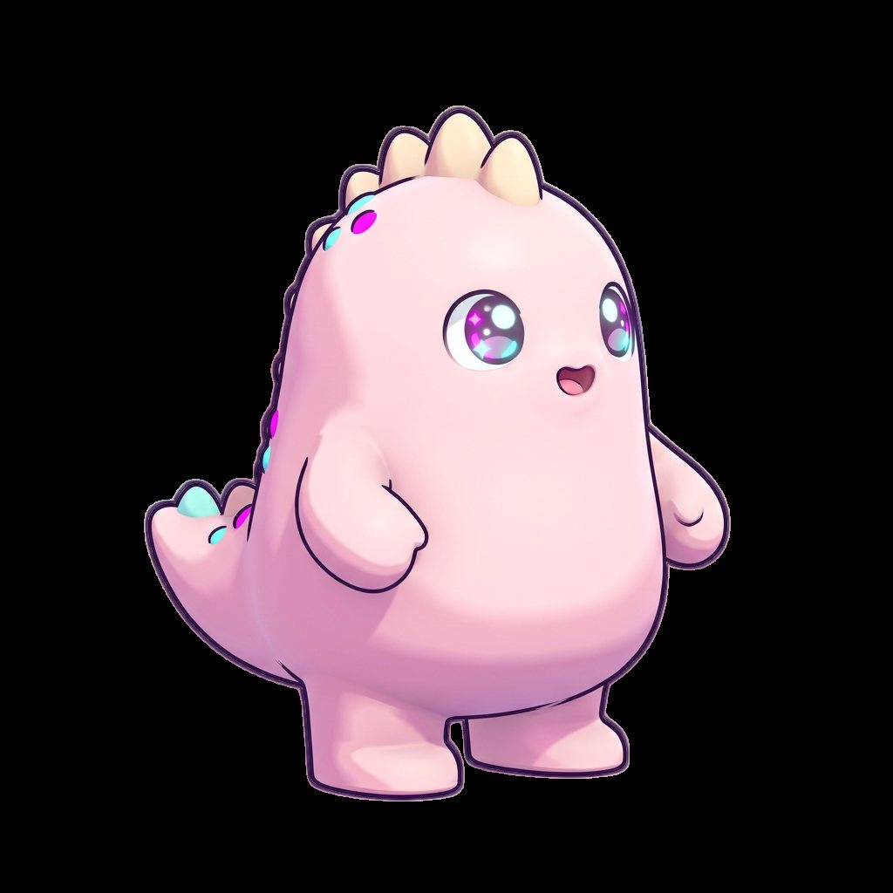
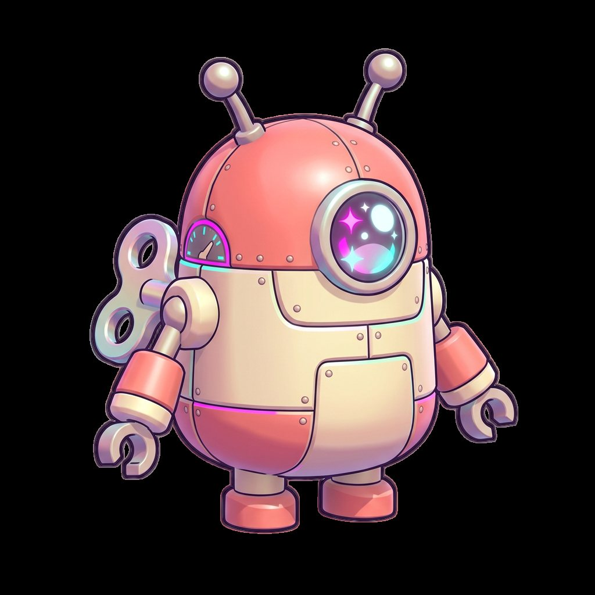
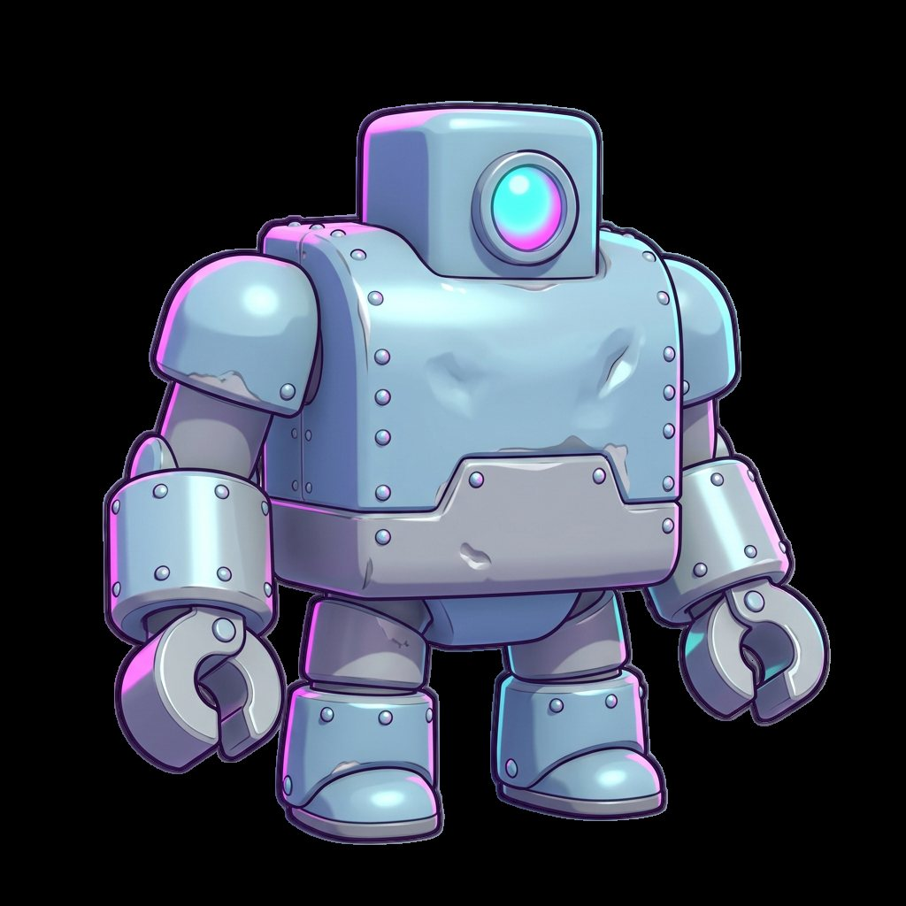
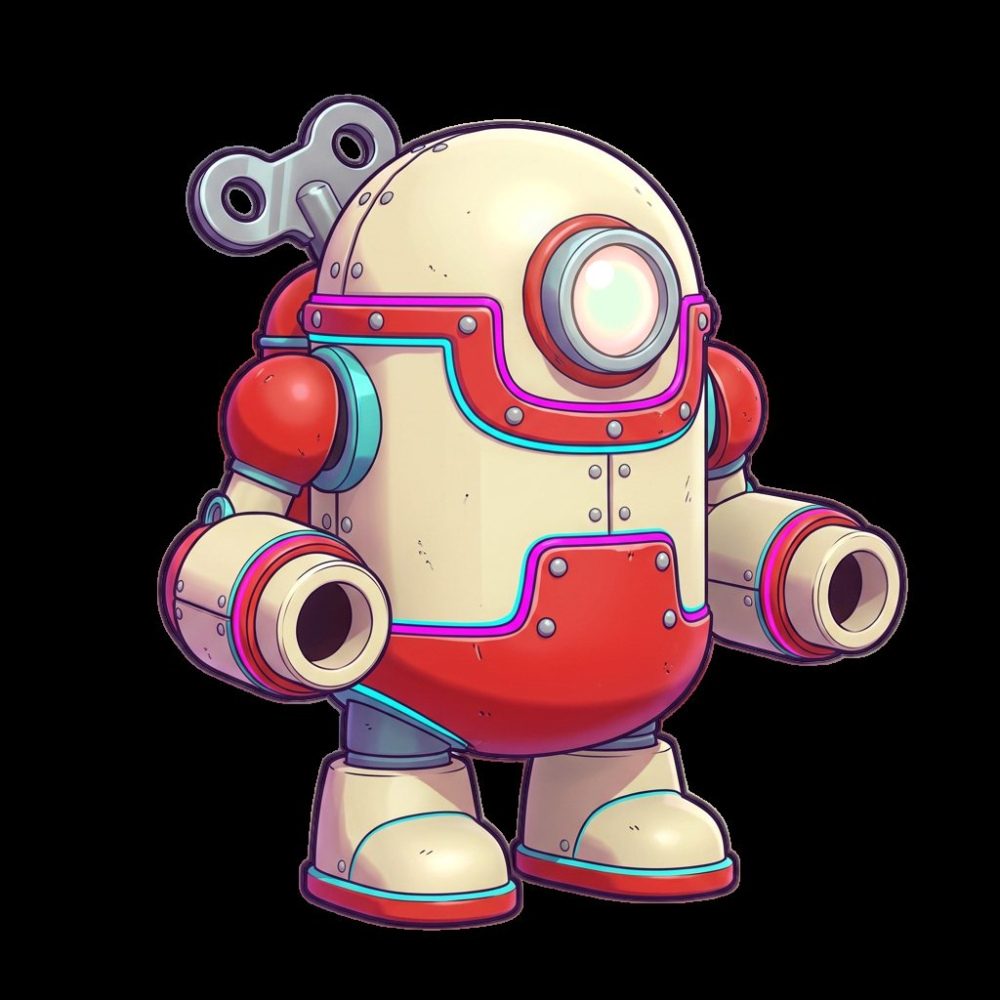

# Pocket Kaiju

A bite-sized 3D arcade brawler where you play Mochi, a pocket-sized pastel kaiju, defending a neon miniature Tokyo from waves of clumsy tin-toy robot invaders.

## Core loop

- Short 3-minute roguelike runs through a tabletop neon city.
- Stomp, tail-whip and charge a rainbow atomic breath.
- Smash chunky toy-like props for coins, health and temporary perks.
- Each run ends with a perk-shaped build that changes the next run.

## Cast

| | | | |
| --- | --- | --- | --- |
|  |  |  |  |
| **Mochi**: the hero, all stomp and sparkle | **Tin Scout**: swarms in packs of six to ten | **Tin Brute**: shields the scouts, then charges | **Tin Titan**: the minute-three boss |

## Look

Rendered 3D toy style: chunky vinyl-collectible proportions, candy pastels with neon magenta and cyan. Mochi's art is the project pillar, so every new image matches it. See `pillars/style-bible.md`.
